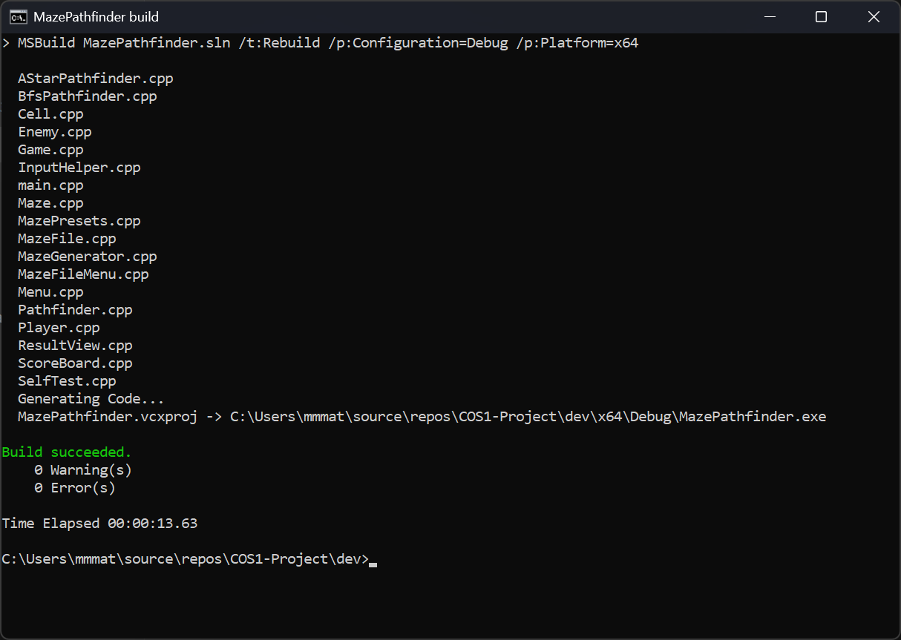
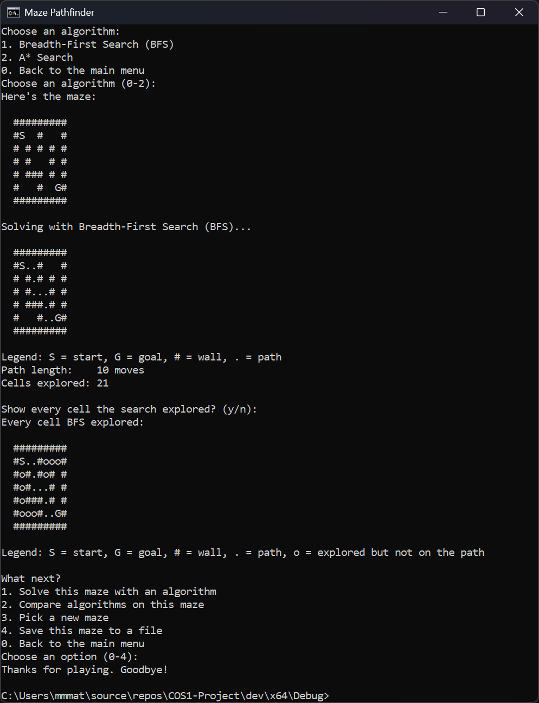
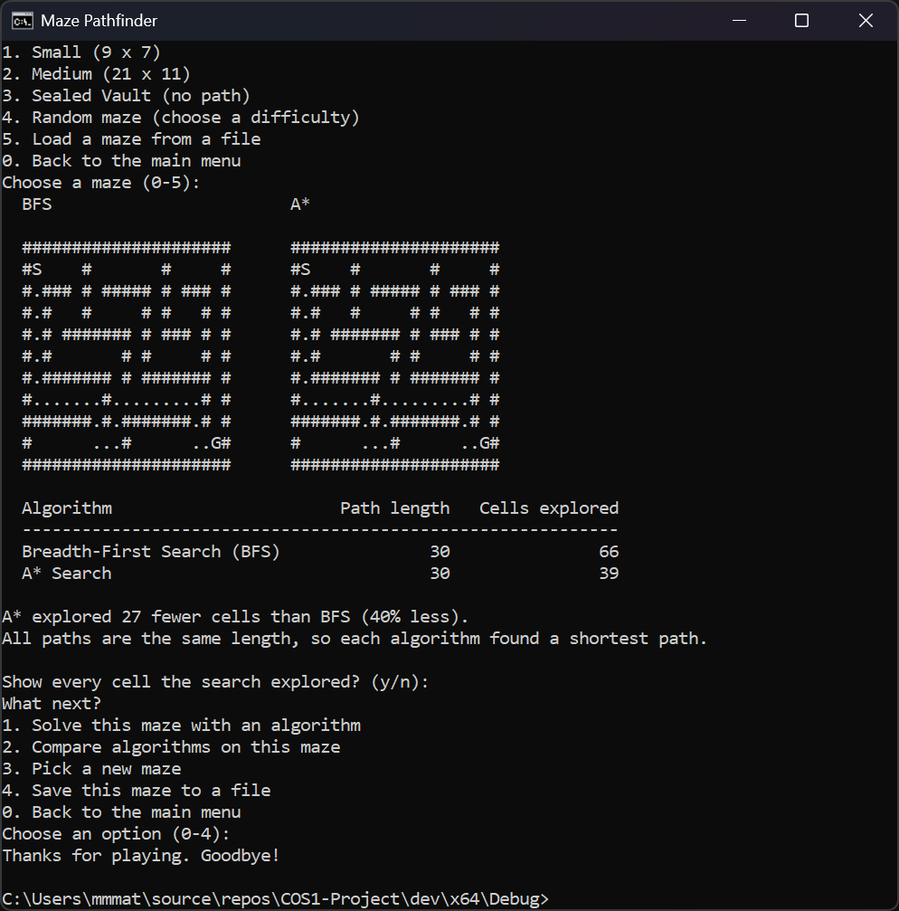

# Milestone 4: File I/O, Save/Load & Final Submission

**COS1 - Project and Portfolio I: Computer Science**
**Matt Moreno**
**Maze Pathfinder** (C++ console application)

This document records how Maze Pathfinder changed during Week 4, the final week. Test evidence is in [testing/milestone4-test-log.md](testing/milestone4-test-log.md), and day-to-day notes are in [changelog/milestone4-progress.md](changelog/milestone4-progress.md).

---

## Where the project started this week (end of Milestone 3)

- Solve a Maze, Compare mode and Play mode were complete, with BFS, A*, random mazes and a fair enemy
- **Nothing was saved:** closing the program lost every maze and every result
- The self-test had 76 checks

## Where it is now

- **Save a maze** to a plain-text file, and **load** it again in a later run, along with any maze the user draws in Notepad
- **Best scores** for Play mode are saved after every win and loaded at startup
- Missing, empty, broken and even binary files are handled with clear messages, never a crash
- A **How to play** screen, and consistent wording and numbering in every menu
- **The Save and Load screens moved out of `Menu`** into a new `MazeFileMenu` class, so `Menu.cpp` went from 640 lines to 550
- The self-test has **98 checks**
- **Every planned Issue is Done.** Three future ideas are in Backlog.

---

## 💾 What Gets Saved, and Why

The assignment asked what information would make sense to keep between runs. For a maze program, I picked two things:

| Data | Why it's worth keeping | File |
|---|---|---|
| **Mazes** | A good random maze, or one the user drew by hand, is worth coming back to: to solve with another algorithm, compare, or show someone. | `mazes/<name>.txt`, one file per maze |
| **Best scores** | Play mode is a game, and a record to beat is the reason to play again. | `scores.txt`, one file for all difficulties |

**Both formats are plain text a person can read and edit:**

```
mazes/small maze.txt          scores.txt
#########                     Easy=16
#S  #   #                     Medium=62
# # # # #                     Hard=200
# #   # #
# ### # #
#   #  G#
#########
```

A maze file is just the maze, drawn with the same symbols the program uses. That means a saved maze can be opened in Notepad, and a maze drawn in Notepad can be loaded, with no conversion step. Loading reuses `Maze::loadFromLayout()`, the same validation the built-in mazes have used since Week 1.

**Close, reopen, load:** both files live next to where the program runs. The program shows the full path after saving and on the How to play screen. A best score set in one run is shown before the next game in the next run, and a saved maze appears in "5. Load a maze from a file" every time the program starts.

---

## ⚙️ Features Added

| Feature | Issue | What it does |
|---|---|---|
| **Save a maze** | #25 | "4. Save this maze to a file" in the What next? menu. Asks for a name (0 cancels), checks it, adds `.txt`, asks before replacing an existing file, creates the `mazes` folder if needed, and shows the full path. Then it returns to What next?, because the maze hasn't changed. |
| **Load a maze** | #26 | "5. Load a maze from a file" in the maze picker lists every `.txt` file in `mazes` by number. A file that can't be used gets a specific reason, and the picker comes back. |
| **Best scores** | #27 | Before each game: `Your best on Medium: 62 turns.` or `No best score on Medium yet. Win to set one!` After a win: first win, new best (with the old best), or still the best. The score is saved right away. |
| **Bad-file tests** | #28 | Self-test checks for garbage, uneven, binary and overwritten files, plus a readable message for unprintable characters (below). |
| **How to play** | #29 | Main menu option 4 explains each mode, the difficulties, every symbol (S G # . o P E X) and where files are saved. |
| **Consistent menus** | #29 | **0 now exits** the main menu, matching every other menu where 0 goes back. Same wording and plurals everywhere. |
| **`MazeFileMenu` class** | #32 | The Save and Load screens moved out of `Menu` into their own class. Nothing the user sees changed (see Refactoring). |

## 🧱 Updates to System Design

**New modules**

| Module | Responsibility |
|---|---|
| `MazeFile` (namespace) | Everything about maze files: `isValidName()`, `withExtension()`, `save()`, `load()`, `listMazes()`, `getFolder()`. Functions only, no state, so a namespace fits better than a class. |
| `ScoreBoard` (class) | Holds the best score per difficulty in a `std::map<Difficulty, int>`. `load()` reports what happened (`Loaded`, `NoFile` or `Repaired`), `save()` writes it, and `recordWin()` decides whether a win is a new best. It has **no console output**, so `Menu` decides what to say and the self-test can check every case. |
| `MazeFileMenu` (class) | The Save and Load **screens**: asks for a file name, lists saved mazes, and explains problems. It holds a `Maze&` (a reference to `Menu`'s maze) and returns a `LoadResult` (`Loaded`, `NotLoaded` or `InputEnded`), so `Menu` only decides *what happens next*. |

**Changes to existing classes**

| Class | Change | Why |
|---|---|---|
| `Maze` | Added `getLayout()`, which turns the grid back into text rows | Saving needs the layout `loadFromLayout()` reads |
| `Maze` | Unknown characters that can't be printed are described: `(character code 0)`, `(a tab)` | A binary file used to print invisible bytes in its error |
| `InputHelper` | Added `readText()` for file names | Same trim, re-ask and end-of-input rules as the other prompts |
| `ResultView` | Now owns `countText()` ("1 move", "2 moves"), shared with `Menu` | Fixed "1 moves" in Solve results |
| `Menu` | Best scores and How to play; `ScoreBoard` and `MazeFileMenu` members. The Save and Load screens moved out (#32). | Menu flow only, not file screens |

**How the file features fit in**

```
Menu
  ├── MazeFileMenu (Save and Load screens, holds Maze&)
  │      └── MazeFile ── save()/load() ── mazes/*.txt
  │             └── Maze::getLayout() / Maze::loadFromLayout()   (same validation as built-in mazes)
  └── ScoreBoard ── load()/save() ── scores.txt
         └── recordWin() after each Play mode win (Game reports the turn count)
```

Each piece has one job. `MazeFile` reads and writes files, `MazeFileMenu` talks to the user about them, and `Menu` decides what happens next. `MazeFile` and `ScoreBoard` print nothing and return results and messages, which is what lets the self-test check every file problem without a person typing anything.

## 🧹 Refactoring: Objects and References (#32)

By Wednesday, the save, load, scores and How to play screens had grown `Menu.cpp` from **364 lines to 640**: the same problem `ResultView` fixed in Week 3. I moved the Save and Load screens into a new `MazeFileMenu` class.

| Before | After | Why it's better |
|---|---|---|
| `Menu::saveCurrentMaze()` and `Menu::chooseFileMaze()`, about 90 lines of file prompts inside `Menu` | `MazeFileMenu::saveMaze()` and `chooseAndLoad()` in their own `.h`/`.cpp` | `Menu` handles menu flow; file screens live in one place |
| Both functions reached into `Menu`'s `m_running` flag through `askText()`/`askInt()` to stop the program when input ended | `MazeFileMenu` **returns** what happened: `saveMaze()` returns `false` if input ended, and `chooseAndLoad()` returns `Loaded`, `NotLoaded` or `InputEnded` | The new class doesn't need to know about `Menu` at all. `Menu` reads the result and decides, which makes the flow easier to follow. |
| `Menu::askText()` existed only for the save screen | Removed | One less wrapper |
| | `MazeFileMenu` holds a **`Maze&`** to `Menu`'s maze, declared after `m_maze` | A reference, not a copy: loading a file changes the one maze everything else uses. Members are built in declaration order, so the maze must exist first (the same rule as `ResultView`). |

**Result:** `Menu.cpp` went from **640 to 550 lines**.

**How I proved nothing changed:**
- All **12 scripted menu sessions** were byte-for-byte identical.
- I built the **previous version** side by side and ran both on **9 save and load scenarios**. All 9 matched exactly, including the files they saved. The scenarios covered:
  - bad and reserved names, and replacing a file
  - broken, empty and binary files
  - no saved mazes, and going back from the file list
  - cancelling a save
  - input ending at the file name, the replace question and the file list
- The self-test still passes **98 of 98**, and the build has **0 warnings**.

## ⚠️ Handling Files That Don't Exist or Aren't Right

| Situation | What happens |
|---|---|
| No `mazes` folder yet (first run) | `There are no saved mazes in ... yet. Save one from the What next? menu, or put a maze .txt file in that folder.` |
| No `scores.txt` yet (first run) | Treated as "no wins yet". No message, because nothing is wrong. |
| A file chosen from the list was deleted in the meantime | `There's no file named "x.txt"`, then back to the picker |
| Empty file, or only blank lines | `"c empty.txt" is empty.` |
| Saved from Notepad (byte order mark, `\r\n` endings, blank line at the end) | Loads normally. All three are stripped. |
| Not a maze: wrong characters, uneven rows, no S or G, two S's | The exact reason and position, e.g. `Row 3 is a different length than the first row.` |
| Binary junk | `Unknown character (character code 0) at row 1, column 1.` |
| Too big (over 101 rows or 201 columns) | Rejected as too big before anything is built |
| A folder named like a maze file | `is a folder` |
| Damaged `scores.txt` (e.g. `Easy=abc`) | Every readable line is kept. The bad lines are named once at startup (`line 1 ("Easy=abc")`) and reset. |
| A file that can't be written (read-only, bad path) | The error is shown and the program carries on |
| Bad file names (`a:b`, `CON`, blank, too long) | Rejected with the reason before anything is written |

## 🧪 Testing and Debugging

- **Self-test: 76 → 98 checks**, all passing. New this week:
  - **Saving (5 checks):** good and bad names, `.txt` handling, exact contents, unwritable paths
  - **Loading (11 checks):** 100 random mazes and every built-in maze save and load back identically; missing, empty, Notepad-style, too big, folder, garbage, uneven, missing goal, two starts, binary, overwriting; folder listing
  - **Best scores (6 checks):** only fewer turns count, round trip, missing file, corrupt lines, duplicates, unwritable file
  - All file tests use a private temp folder that is deleted afterward, so testing never touches the user's real mazes or scores
- **Menu tests:** every prompt was tested with good input, bad input, and input ending early. For best scores, five separate program runs in a row confirmed that scores really persist between runs: a first win, a tie, beating an old score, a corrupt file, and a read-only file.
- **Regression:** the 12 fixed-seed scripted sessions from Week 3 were compared with the previous version after every Issue. The only differences were the new menu lines each Issue added, and the #32 refactor changed nothing at all.
- **Final whole-application test:** a fresh clone of the public repo builds in Debug and Release, and 20 runs of 3,000 random inputs each (bad numbers, huge lines, Unicode, reserved file names, random moves) never crashed or hung. That covered about 270 Play mode games and 280 solves.
- **Final screenshots** are in `images/`:
  - `final-run.png`: a full rebuild, with "Build succeeded, 0 Warning(s), 0 Error(s)"
  - `final-features.png`: Solve a maze with BFS, then the explored-cells overlay
  - `final-features-compare.png`: Compare mode, BFS and A* side by side with the stats table





**Bugs found and fixed this week**

| Bug | Fix |
|---|---|
| `File names can't contain :.` was hard to read | The character is quoted: `can't contain ":"` |
| A test script could save files into whatever folder it ran from | Test scripts run in their own scratch folder, and the self-test uses a temp folder |
| A maze drawn in Notepad failed with "Unknown character" on row 1 | Strip Notepad's invisible byte order mark and `\r` line endings |
| A binary file printed raw, invisible bytes in its error | Describe unprintable characters by code |
| "Path length: 1 moves", "1 fewer cells" | Shared `countText()` |
| Exit was 4 on the main menu but 0 meant "back" everywhere else | 0 exits everywhere |

## 💭 What I Changed and Why

- **Plain text instead of a custom format.** A saved maze is the maze itself, so the user can read it, edit it, or draw a new one, and loading gets the existing validation for free. A random maze's seed isn't saved, but it doesn't need to be: the full layout is.
- **A damaged scores file is repaired, not thrown away.** If one line is bad, the other difficulties' records are still good. Wiping everything would punish the user for one typo.
- **`ScoreBoard` prints nothing.** It returns `Loaded`, `NoFile` or `Repaired` and lets `Menu` choose the words, the same pattern as `Game` in Week 3. A missing file is normal on a first run, so it gets no message at all.
- **0 = Exit.** Every submenu already used 0 for "back". One rule everywhere is easier to learn than one exception, and the How to play screen states the rule in its first line.
- **Testing what users actually do.** The Notepad byte order mark, binary files and overwriting a bigger file all came from asking "what will a real person do with this folder?", not from the happy path.

## ✅ Final Requirements Checklist

| Requirement | Where it is in the project |
|---|---|
| 3+ classes beyond `main`, in `.h`/`.cpp` | 14 classes, counting the `PathResult` struct (`Menu`, `ResultView`, `MazeFileMenu`, `Cell`, `Maze`, `Pathfinder`, `BfsPathfinder`, `AStarPathfinder`, `MazeGenerator`, `Player`, `Enemy`, `Game`, `ScoreBoard`, `PathResult`) plus helper namespaces, in 17 headers and 18 source files |
| At least one vector | `Maze` stores its grid as `vector<vector<Cell>>`; paths are `vector<Cell*>`; `Menu` keeps `vector<unique_ptr<Pathfinder>>` |
| Pointers / references / dynamic memory | `Cell*` parent pointers rebuild paths; `unique_ptr<Pathfinder>` gives polymorphism; `Enemy` holds a `Pathfinder&`; `ResultView` and `MazeFileMenu` hold references to `Menu`'s members |
| Persistent menu with a clear exit | The main menu loops until **0. Exit**, and running out of input also exits cleanly |
| Multiple interacting objects | `Game` runs `Player` and `Enemy`; `Enemy` uses a `Pathfinder`; `Menu` connects `Maze`, `ResultView`, `MazeFileMenu` and `ScoreBoard` |
| Meaningful interaction | Solve, Compare and Play modes, plus Save, Load and How to play |
| Input validation | `InputHelper` re-asks on every bad number, key, yes/no or blank line; file names are checked before saving |
| File I/O: Save **and** Load, handles missing files | `MazeFile` (mazes) and `ScoreBoard` (best scores); see the table of file situations above |
| Multi-file, Visual Studio C++ console app | `dev/MazePathfinder.sln`, C++20, x64; no graphics libraries |
| Clear purpose | Shows *how* pathfinding algorithms search, then turns that into a game |

## 📋 Project Management

- **Week 4 Issues** (created Monday 11/16, all on the board): **#25** Save a maze, **#26** Load a maze, **#27** Best scores, **#28** Save/Load tests, **#29** How to play and prompt polish. **#11** (Save and Load) was the parent feature.
- Each Issue moved To Do → In Progress → Done as it was worked on. #28 and #29 started in Backlog and were moved to To Do once they were planned for this week, because Backlog is for ideas I won't finish in the course.
- **Commits were spread across the week:** 6 on Monday (#25, #26) and 7 on Wednesday (#27, #28, #29), each one a single change with its Issue number.
- **Pull Request #30** merged #25–#29 and this document from `dev` into `main` on Wednesday, linked to the board.
- On Wednesday I added my three future ideas to **Backlog** (#31, #32, #33) so the board shows what I'd do next. On Friday I pulled **#32** (the `Menu` split) back in for the final milestone's objects and refactoring step, and it went Backlog → In Progress → Done.
- **Pull Request #34** merged #32 and the final screenshots into `main`.
- **Pull Request #35** (the final one) adds my Final Project Stand-Up to the README.
- **Board at the end of the course:** every planned Issue Done, nothing in To Do or In Progress, and #31 and #33 in Backlog as future ideas.

## 🔮 Possible Future Improvements

- **Fairer scores (#31):** count *extra moves* compared with the shortest route (0 = perfect), since a lucky short maze makes an easier record.
- **Save a game in progress (#33)** in Play mode, not just finished results.
- **Weighted search:** add Dijkstra's algorithm with mazes where some cells cost more to cross. It would plug straight into the `Pathfinder` base class.
